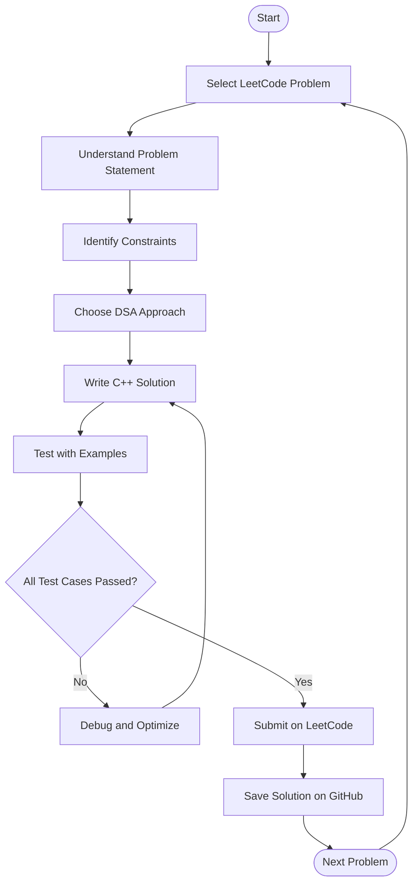

# 🚀 LeetCode Problem Solutions

<p align="center">
  
  
  
</p>

<p align="center">
  A collection of LeetCode problem solutions implemented in <b>C++</b>, focused on improving problem-solving skills and mastering Data Structures and Algorithms.
</p>

---

## 📌 About This Repository

Welcome to my **LeetCode Problem Solutions** repository!

This repository contains my solutions to various LeetCode problems, implemented using **C++**.

The main goal is to strengthen programming fundamentals, improve logical thinking, and develop efficient problem-solving skills.

## 🎯 Objectives

- Practice Data Structures and Algorithms.
- Improve logical and analytical thinking.
- Understand optimized approaches.
- Learn time and space complexity.
- Prepare for technical interviews and coding assessments.
- Maintain a consistent coding practice.

---

## 🔄 Problem Solving Workflow



---

## 📊 Repository Overview

| Category | Details |
|---|---|
| Platform | LeetCode |
| Programming Language | C++ |
| Repository Type | DSA Practice |
| Focus | Problem Solving |
| Topics | Arrays, Strings, DP, Trees, Graphs, etc. |
| Purpose | Coding Practice & Interview Preparation |

---

## 📚 Problem Categories

| # | Topic | Description |
|---|---|---|
| 1 | Arrays | Array manipulation and searching |
| 2 | Strings | String processing and patterns |
| 3 | Hashing | Hash maps and hash sets |
| 4 | Two Pointers | Efficient pointer-based techniques |
| 5 | Sliding Window | Subarray and substring problems |
| 6 | Binary Search | Searching in sorted data |
| 7 | Linked List | Linked list operations |
| 8 | Stack & Queue | Linear data structures |
| 9 | Trees | Binary trees and BST |
| 10 | Graphs | BFS, DFS and graph algorithms |
| 11 | Dynamic Programming | Optimization using subproblems |
| 12 | Greedy | Greedy algorithms |
| 13 | Sorting | Sorting techniques |
| 14 | Backtracking | Recursive search techniques |

---

## 💻 Language & Technologies

<p>
  
  
  
  
  
</p>

---

## 📁 Repository Structure

```text
Leetcode-Problem/
│
├── Arrays/
├── Strings/
├── Hashing/
├── Two-Pointers/
├── Sliding-Window/
├── Binary-Search/
├── Linked-List/
├── Stack-Queue/
├── Trees/
├── Graphs/
├── Dynamic-Programming/
├── Greedy/
│
└── README.md
```

*Note: Folder structure is illustrative. Update it according to the actual folders in your repository.*

---

## 📈 Learning Approach

1. Understand the problem statement.
2. Analyze input constraints and edge cases.
3. Think of a brute-force approach.
4. Optimize the solution.
5. Implement the solution in C++.
6. Analyze time and space complexity.
7. Test and submit the solution.
8. Save the code in this repository.

---

## 🌟 Goals

- [ ] Solve more LeetCode problems.
- [ ] Master important DSA concepts.
- [ ] Improve problem-solving speed.
- [ ] Practice medium and hard problems.
- [ ] Prepare for technical interviews.
- [ ] Maintain consistency in coding practice.

---

## 👩‍💻 Author

**Anshika Mishra**

- GitHub: [@AnshikaMishra6373](https://github.com/AnshikaMishra6373)
- LeetCode: [View My Solutions](https://github.com/AnshikaMishra6373/Leetcode-Problem)

---

## ⭐ Support

If you find this repository useful, consider giving it a ⭐.

**Keep Learning | Keep Practicing | Keep Coding 🚀**
